<h1 align="center">🎓 Gestión de Estudiantes</h1>

<p align="center">
  Aplicación web <strong>CRUD con Login</strong> construida con el patrón <strong>MVC</strong> usando <strong>Laravel + React</strong>.
</p>

<p align="center">
  
  
  
  
  
  
</p>

<p align="center">
  🌐 <strong>Demo en línea:</strong> <a href="https://gestion-estudiantes.onrender.com">https://gestion-estudiantes.onrender.com</a>
  <br><sub>(plan gratuito de Render: la primera carga puede tardar ~1 minuto mientras el servidor despierta)</sub>
</p>

<p align="center">
  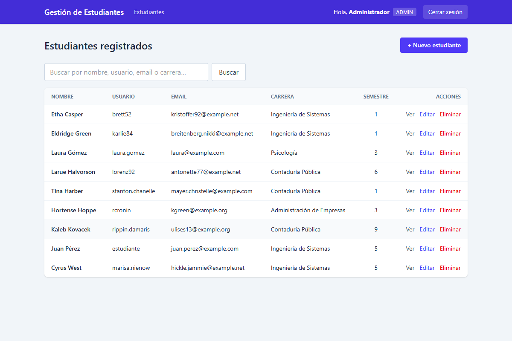
</p>

---

## 📑 Índice

- [Descripción del proyecto](#-descripción-del-proyecto)
- [Requisitos de la actividad y cómo se cumplen](#-requisitos-de-la-actividad-y-cómo-se-cumplen)
- [🚨 Dato sensible: validación de la cédula en el back-end](#-dato-sensible-validación-de-la-cédula-en-el-back-end)
- [Relaciones entre tablas: dropdowns dependientes Facultad → Carrera](#-relaciones-entre-tablas-dropdowns-dependientes-facultad--carrera)
- [Funcionalidades y demostración](#-funcionalidades-y-demostración)
- [Arquitectura MVC y base de datos](#️-arquitectura-mvc-y-base-de-datos)
- [Seguridad: login, rutas protegidas y cifrado](#-seguridad-login-rutas-protegidas-y-cifrado)
- [Instalación local](#-instalación-local)
- [Despliegue (deploy)](#️-despliegue-deploy)
- [Pruebas automáticas](#-pruebas-automáticas)
- [Tecnologías utilizadas](#️-tecnologías-utilizadas)
- [Estructura de carpetas](#-estructura-de-carpetas)

---

## 📝 Descripción del proyecto

Sistema de **registro de estudiantes**:

- Cada **estudiante** crea su propia cuenta con sus datos personales y académicos (nombre, apellido, **cédula**, usuario, correo, **facultad / carrera** y semestre) y, al iniciar sesión, ve **su perfil**.
- El **administrador** ve a **todos los estudiantes registrados** y puede **crearlos, consultarlos, editarlos y eliminarlos** (CRUD).

La sección de gestión está **protegida por un sistema de autenticación**. Si alguien intenta abrir cualquier URL protegida sin sesión, el servidor lo redirige al login. Si un estudiante intenta entrar al CRUD, el servidor responde **403 – Acceso denegado**.

## ✅ Requisitos de la actividad y cómo se cumplen

| Requisito | Implementación |
|---|---|
| 🚨 **Validación en back-end de un dato sensible** | La **cédula ecuatoriana** se valida **en el servidor** con el algoritmo oficial *módulo 10* y se verifica que no esté repetida, antes de grabarse en la base de datos. Ver [detalle](#-dato-sensible-validación-de-la-cédula-en-el-back-end). |
| 🔗 **Clave foránea seleccionada con dropdown, no con input** | El estudiante guarda `carrera_id` (FK → `carreras`). El formulario muestra un dropdown de **Facultad** y, al escogerla, el dropdown de **Carrera** se carga desde el servidor solo con las carreras de esa facultad. Ver [detalle](#-relaciones-entre-tablas-dropdowns-dependientes-facultad--carrera). |
| 🗂️ **Versionado en Git** con buen README | Este repositorio y este documento. |
| 🚀 **Desplegado** | En [Render](https://render.com) con Docker + PostgreSQL. Ver [Despliegue](#️-despliegue-deploy). |
| MVC, CRUD y login | Laravel (Modelo y Controlador) + React vía Inertia (Vista), autenticación con contraseñas bcrypt y rutas protegidas. |

## 🚨 Dato sensible: validación de la cédula en el back-end

Para este sistema la **cédula de identidad** es el dato sensible: identifica de forma única a cada estudiante. Por eso **no se confía en el navegador**: aunque alguien desactive JavaScript o envíe la petición directamente con `curl` o Postman, el **servidor** rechaza cualquier cédula inválida o repetida **antes** de que llegue a la base de datos.

### Qué se valida (en el servidor)

| # | Regla | Ejemplo rechazado |
|---|---|---|
| 1 | Exactamente **10 dígitos numéricos** | `171003406`, `17100340AB` |
| 2 | Los 2 primeros dígitos son una **provincia válida** (01–24, o 30 = registrados en el exterior) | `2510034065` |
| 3 | El **tercer dígito es menor que 6** (persona natural) | `1760034065` |
| 4 | El **dígito verificador** (10.º) coincide con el algoritmo **módulo 10** | `1710034066` |
| 5 | **No existe** otro estudiante con la misma cédula (también hay un índice `UNIQUE` en la tabla) | — |

Además, antes de validar se **normaliza** la entrada: se quitan espacios y guiones (`171003406-5` → `1710034065`).

### Algoritmo módulo 10

Los 9 primeros dígitos se multiplican por los coeficientes `2 1 2 1 2 1 2 1 2`; si un producto es mayor que 9 se le resta 9; se suman los resultados y el verificador es lo que falta para llegar a la siguiente decena.

```text
Cédula:        1   7   1   0   0   3   4   0   6  | 5
Coeficientes:  2   1   2   1   2   1   2   1   2
Producto:      2   7   2   0   0   3   8   0  12 → 12 - 9 = 3
Suma: 2+7+2+0+0+3+8+0+3 = 25   →   verificador = (10 - 25 % 10) % 10 = 5  ✅
```

### Dónde está el código

```php
// app/Http/Requests/EstudianteRequest.php  (se ejecuta ANTES del controlador)
'cedula' => ['required', 'string', new CedulaEcuatoriana, Rule::unique('users')->ignore($estudiante)],
```

- [`app/Support/Cedula.php`](app/Support/Cedula.php): algoritmo (validar y calcular el dígito verificador).
- [`app/Rules/CedulaEcuatoriana.php`](app/Rules/CedulaEcuatoriana.php): regla de validación de Laravel que usa ese algoritmo.
- [`app/Http/Requests/EstudianteRequest.php`](app/Http/Requests/EstudianteRequest.php): aplica la regla al crear, editar y en el registro público.
- [`tests/Feature/CedulaTest.php`](tests/Feature/CedulaTest.php): pruebas que envían cédulas inválidas directamente al servidor y comprueban que **no se graba nada**.

Si la validación falla, Laravel devuelve el error y el formulario lo muestra bajo el campo; el controlador nunca llega a ejecutar `Estudiante::create()`.

## 🔗 Relaciones entre tablas: dropdowns dependientes Facultad → Carrera

La carrera ya **no es texto libre**: es una **clave foránea** a un catálogo. Igual que en el ejemplo *país → provincia → ciudad*, aquí la relación es **facultad → carrera → estudiante**:

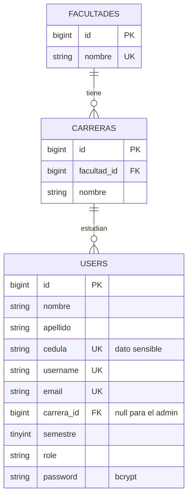

### Cómo funciona el formulario

1. El controlador envía a la vista la lista de **facultades** → se llena el primer dropdown.
2. Mientras no se escoja una facultad, el dropdown de **Carrera** está deshabilitado (*"Primero selecciona una facultad"*).
3. Al escoger una facultad, React hace `GET /facultades/{id}/carreras` y el servidor responde (JSON) **solo con las carreras de esa facultad**; con ellas se llena el segundo dropdown.
4. Si se cambia de facultad, la carrera elegida se borra y se cargan las nuevas opciones (la petición anterior se cancela con `AbortController`).
5. Al **editar**, la facultad y la carrera del estudiante vienen preseleccionadas.

```jsx
// resources/js/Components/CamposEstudiante.jsx
useEffect(() => {
    if (!facultadId) return;
    const control = new AbortController();
    fetch(`/facultades/${facultadId}/carreras`, { headers: { Accept: 'application/json' }, signal: control.signal })
        .then((r) => r.json())
        .then(setCarreras);
    return () => control.abort();
}, [facultadId]);
```

### Y también se valida en el servidor

Un dropdown se puede manipular desde las herramientas del navegador, así que el back-end comprueba que la carrera **exista y pertenezca a la facultad elegida**:

```php
'facultad_id' => ['required', 'integer', Rule::exists('facultades', 'id')],
'carrera_id'  => ['required', 'integer', Rule::exists('carreras', 'id')->where('facultad_id', $this->integer('facultad_id'))],
```

Archivos: [`CatalogoController.php`](app/Http/Controllers/CatalogoController.php) (endpoint JSON), modelos [`Facultad`](app/Models/Facultad.php) y [`Carrera`](app/Models/Carrera.php), migraciones en [`database/migrations/`](database/migrations/), catálogo de ejemplo en [`FacultadCarreraSeeder.php`](database/seeders/FacultadCarreraSeeder.php) (5 facultades, 18 carreras) y pruebas en [`tests/Feature/FacultadCarreraTest.php`](tests/Feature/FacultadCarreraTest.php).

## ✨ Funcionalidades y demostración

🎥 **Video demostrativo:** [Ver en YouTube](https://youtu.be/vkZF2S__drY)

| Funcionalidad | Quién | Descripción |
|---|---|---|
| 📝 **Registro** | Visitante | Crea su cuenta de estudiante con validaciones en el servidor (cédula válida y única, usuario y correo únicos, facultad/carrera coherentes, contraseña de mínimo 8 caracteres con confirmación) |
| 🔐 **Iniciar sesión** | Todos | Usuario y contraseña, opción "Recordarme". El admin llega al CRUD y el estudiante a su perfil |
| 👤 **Mi perfil** | Estudiante | Ve sus propios datos, incluida su facultad y carrera |
| 📋 **Listar y buscar** | Admin | Tabla de todos los estudiantes, con búsqueda (nombre, cédula, usuario, email o carrera) y paginación |
| ➕ **Crear** | Admin | Registra un estudiante; facultad y carrera con dropdowns dependientes |
| 👁️ **Ver detalle** | Admin | Ficha completa del estudiante |
| ✏️ **Editar** | Admin | Actualiza datos; la contraseña es opcional (vacía = no se cambia) |
| 🗑️ **Eliminar** | Admin | Borrado con confirmación previa |
| 🚫 **Rutas protegidas** | — | Sin sesión → `/login`. Estudiante en el CRUD → **403** |
| 🚪 **Cerrar sesión** | Todos | Invalida la sesión, limpia el historial del navegador y regresa al login |

### Capturas

| Login | Credenciales incorrectas |
|---|---|
| 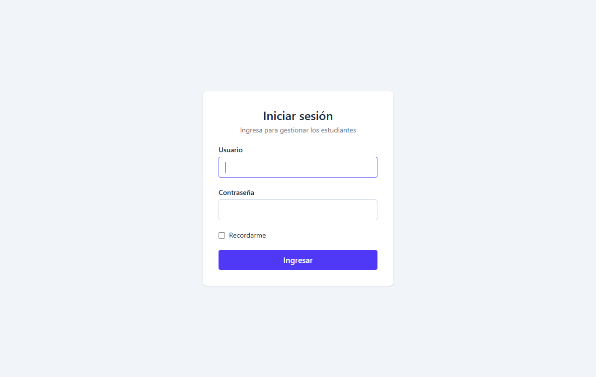 | 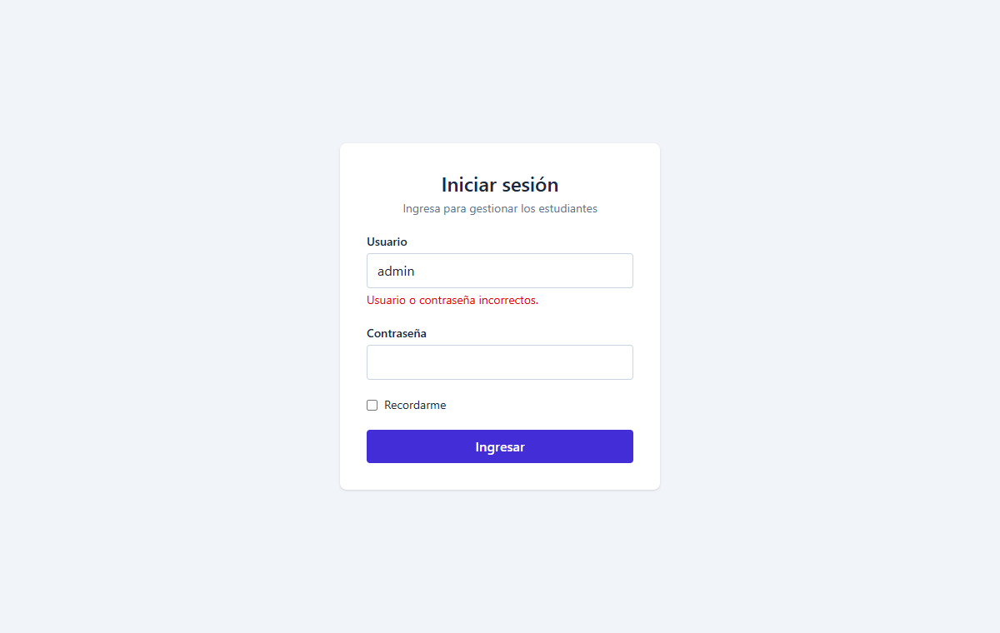 |

| Registro con validaciones | Perfil del estudiante tras registrarse |
|---|---|
| 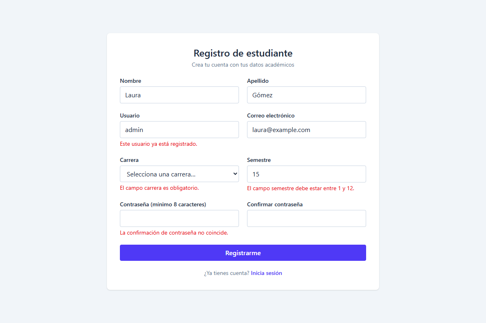 | 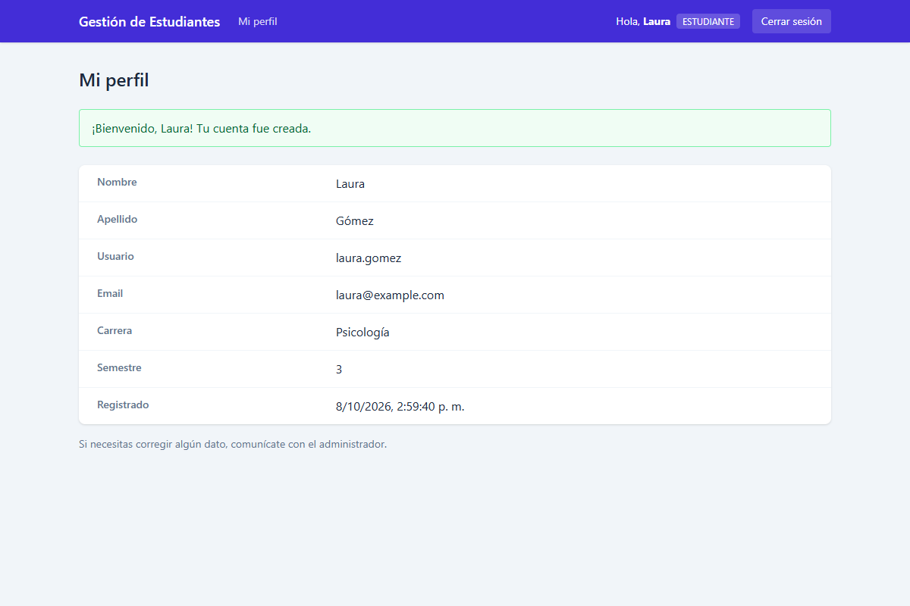 |

| Estudiante intenta entrar al CRUD (403) | Admin: estudiantes registrados (Leer) |
|---|---|
| 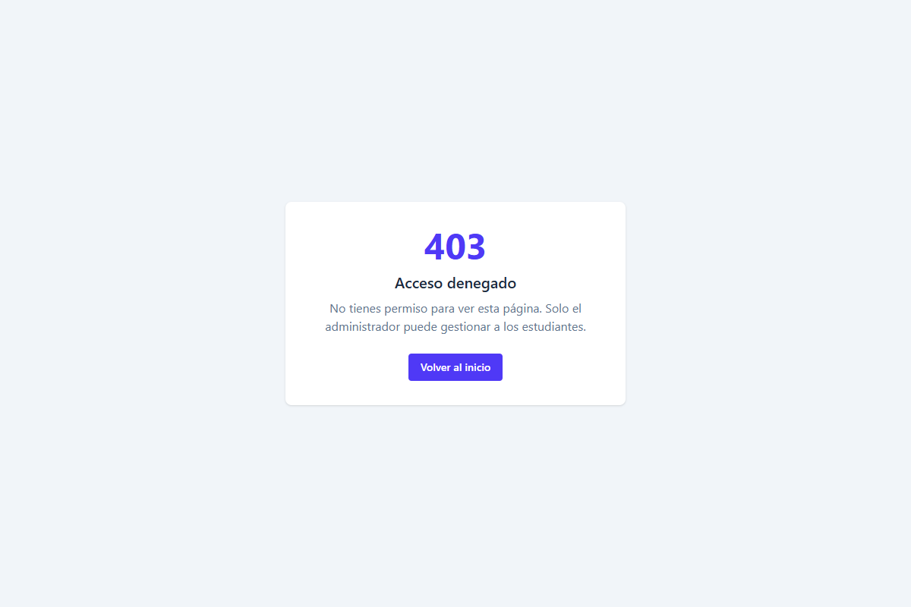 |  |

| Admin: crear con validaciones | Admin: editar (Actualizar) |
|---|---|
| 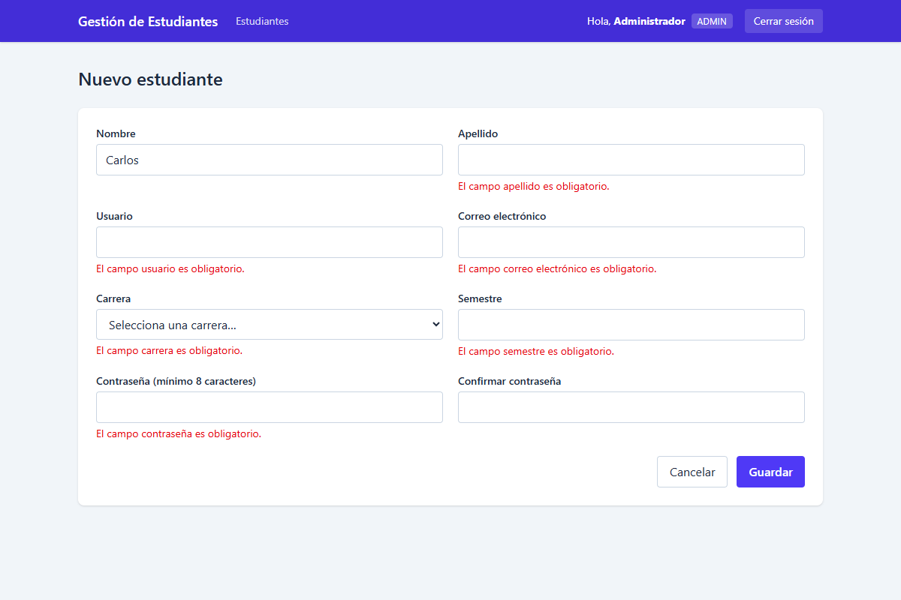 | 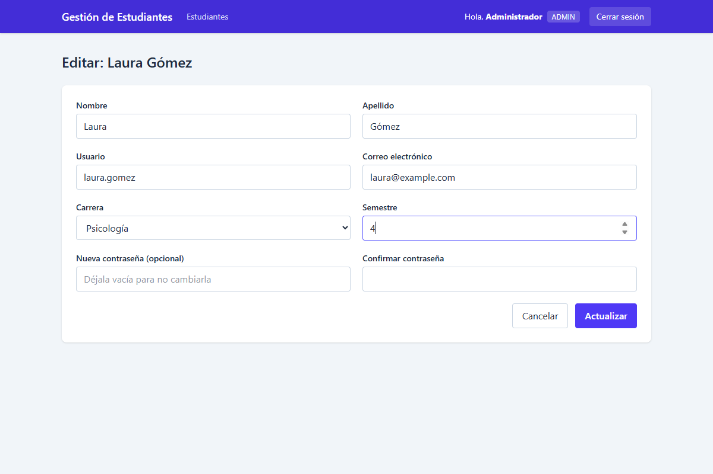 |

| Admin: detalle |
|---|
| 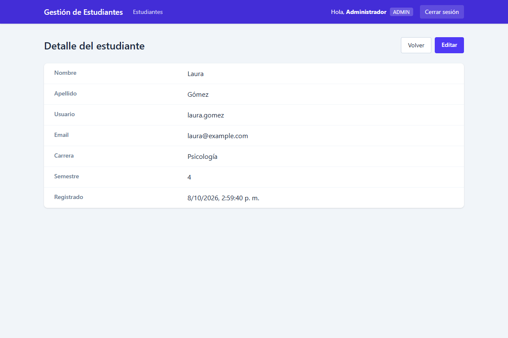 |

## 🏛️ Arquitectura MVC y base de datos

Laravel y React se conectan con **[Inertia.js](https://inertiajs.com)**. Así todo vive en **un solo proyecto MVC**: el controlador de Laravel devuelve un componente React como si fuera una vista. No hace falta una API REST aparte ni tokens; se usan las rutas y la sesión de Laravel.

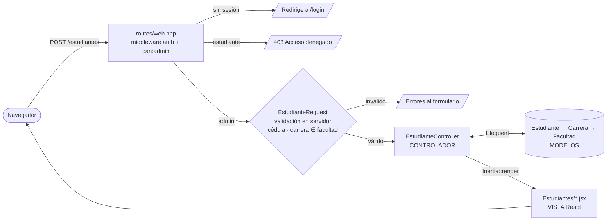

### Una sola tabla para usuarios y estudiantes

Los estudiantes **son** los usuarios del sistema: todo se guarda en la tabla `users`. Dos modelos trabajan sobre esa misma tabla:

- **`User`**: cualquier persona que inicia sesión (admin o estudiante). Lo usa el login.
- **`Estudiante`** (`extends User`): aplica un *global scope* `where role = 'estudiante'`. Lo usa el CRUD, así que **el admin nunca aparece en el listado ni se puede editar o eliminar desde ahí**, y todo lo que se crea con este modelo queda con rol estudiante.

| Capa | Archivos |
|---|---|
| **Modelo** | [`User.php`](app/Models/User.php), [`Estudiante.php`](app/Models/Estudiante.php), [`Facultad.php`](app/Models/Facultad.php), [`Carrera.php`](app/Models/Carrera.php); migraciones en [`database/migrations/`](database/migrations/) |
| **Vista** | [`resources/js/Pages/`](resources/js/Pages/): `Auth/Login.jsx`, `Auth/Register.jsx`, `Perfil.jsx`, `Estudiantes/{Index,Create,Edit,Show,Form}.jsx`, `Error.jsx`; componentes en [`resources/js/Components/`](resources/js/Components/) |
| **Controlador** | [`EstudianteController.php`](app/Http/Controllers/EstudianteController.php) (CRUD), [`AuthController.php`](app/Http/Controllers/AuthController.php) (registro, login y logout), [`PerfilController.php`](app/Http/Controllers/PerfilController.php) (inicio y perfil), [`CatalogoController.php`](app/Http/Controllers/CatalogoController.php) (carreras por facultad) |
| **Validación** | [`EstudianteRequest.php`](app/Http/Requests/EstudianteRequest.php) + regla [`CedulaEcuatoriana.php`](app/Rules/CedulaEcuatoriana.php) |
| **Rutas** | [`routes/web.php`](routes/web.php) |

### Rutas

| Operación | Método | URL | Acción | Quién puede |
|---|---|---|---|---|
| Iniciar sesión | `GET` / `POST` | `/login` | `showLogin` / `login` | Visitante |
| Registrarse | `GET` / `POST` | `/register` | `showRegister` / `register` | Visitante |
| Carreras de una facultad (JSON) | `GET` | `/facultades/{id}/carreras` | `CatalogoController@carreras` | Todos |
| Inicio (redirige según el rol) | `GET` | `/` | `inicio` | Con sesión |
| Mi perfil | `GET` | `/perfil` | `show` | Con sesión |
| Leer (listado) | `GET` | `/estudiantes` | `index` | Admin |
| Leer (detalle) | `GET` | `/estudiantes/{id}` | `show` | Admin |
| Crear | `GET` + `POST` | `/estudiantes/create` + `/estudiantes` | `create` / `store` | Admin |
| Actualizar | `GET` + `PUT` | `/estudiantes/{id}/edit` + `/estudiantes/{id}` | `edit` / `update` | Admin |
| Eliminar | `DELETE` | `/estudiantes/{id}` | `destroy` | Admin |

## 🔒 Seguridad: login, rutas protegidas y cifrado

### Rutas protegidas

```php
// routes/web.php
Route::middleware(['auth', 'inertia.encrypt'])->group(function () {
    Route::get('/', [PerfilController::class, 'inicio'])->name('inicio');
    Route::post('/logout', [AuthController::class, 'logout'])->name('logout');
    Route::get('/perfil', [PerfilController::class, 'show'])->name('perfil');

    // Solo el administrador: CRUD de todos los estudiantes (otro usuario recibe 403)
    Route::resource('estudiantes', EstudianteController::class)->middleware('can:admin');
});
```

- **`auth`** se ejecuta **en el servidor**. Si no hay sesión, Laravel redirige a `/login` antes de llegar al controlador.
- **`can:admin`** usa un *Gate* definido en [`AppServiceProvider.php`](app/Providers/AppServiceProvider.php). Si un estudiante escribe `/estudiantes` a mano, el servidor responde **403**.
- **`guest`** protege `/login` y `/register`: un usuario ya autenticado es enviado a su página de inicio.
- Al **cerrar sesión** se limpia el historial del navegador (`inertia.encrypt` + `Inertia::clearHistory()`).
- El campo `role` **no está en `$fillable`**: nadie puede registrarse como administrador enviando `role=admin`.

### Cifrado de contraseñas

Las contraseñas **nunca se guardan en texto plano**. Se cifran con **bcrypt** (cast `'password' => 'hashed'` en el modelo `User`), que es lento a propósito y añade un *salt* aleatorio, así que dos usuarios con la misma clave tienen hashes distintos. Para verlos: `php artisan usuarios:listar`.

### Otras medidas

- 🔁 **Regeneración de sesión** al iniciar sesión, contra la fijación de sesión.
- 🛡️ **Protección CSRF** en todos los formularios.
- ⏱️ **Límite de intentos**: máximo 5 intentos de login o registro por minuto (`throttle:5,1`).
- ✅ **Validación en el servidor** de todos los datos, incluida la cédula y la coherencia facultad/carrera.

## 🚀 Instalación local

### Requisitos

- PHP 8.3 o superior, con las extensiones `pdo_sqlite`, `mbstring`, `openssl`, `fileinfo`
- [Composer](https://getcomposer.org/)
- [Node.js](https://nodejs.org/) 20 o superior y npm

> **Windows (PC nueva):** se puede instalar todo con `winget`:
> ```powershell
> winget install Git.Git OpenJS.NodeJS.LTS PHP.PHP.8.4
> ```
> Luego copia `php.ini-development` a `php.ini` en la carpeta de PHP, descomenta `extension_dir = "ext"` y las líneas `extension=curl`, `fileinfo`, `mbstring`, `openssl`, `pdo_sqlite`, `zip`, e instala Composer desde [getcomposer.org](https://getcomposer.org/download/).

### Pasos

```bash
# 1. Clonar el repositorio
git clone https://github.com/Miguel14011/Login_Crud_Estudiantes.git
cd Login_Crud_Estudiantes

# 2. Instalar dependencias
composer install
npm install

# 3. Configurar el entorno
cp .env.example .env
php artisan key:generate

# 4. Crear la base de datos (SQLite) con datos de ejemplo
touch database/database.sqlite        # en Windows: type nul > database\database.sqlite
php artisan migrate --seed

# 5. Compilar el frontend y levantar el servidor
npm run build
php artisan serve
```

Abre **http://127.0.0.1:8000** e ingresa con:

| Usuario | Contraseña | Rol |
|---|---|---|
| `admin` | `admin123` | Administrador |
| `estudiante` | `estudiante123` | Estudiante |

O crea tu propia cuenta de estudiante desde **Regístrate** (`/register`). Cédulas válidas para probar: `1710034065` (ya usada por el estudiante de prueba, sirve para ver el error de cédula repetida) o `0102030400` (usa también una inválida, como `1710034066`, para ver el error del servidor).

> 💡 Mientras desarrollas, usa `npm run dev` en otra terminal para ver los cambios de React al instante.

### Comandos útiles

| Comando | Descripción |
|---|---|
| `php artisan usuarios:listar` | Muestra los usuarios con su rol y su contraseña cifrada |
| `php artisan migrate:fresh --seed` | ⚠️ **Borra todo** y deja solo los datos de ejemplo |
| `php artisan test` | Ejecuta las pruebas automáticas |

## ☁️ Despliegue (deploy)

La aplicación está desplegada en **[Render](https://render.com)** usando Docker y una base de datos **PostgreSQL**. Todo está definido como código en el repositorio:

| Archivo | Qué hace |
|---|---|
| [`Dockerfile`](Dockerfile) | Imagen en 3 etapas: compila React con Node, instala dependencias con Composer y arma la imagen final con PHP 8.4 + Apache |
| [`docker/start.sh`](docker/start.sh) | Al arrancar: cachea la configuración, ejecuta las migraciones y carga los datos de ejemplo **solo si la base está vacía** (`php artisan app:sembrar-si-vacia`) |
| [`render.yaml`](render.yaml) | *Blueprint* de Render: crea el servicio web y la base PostgreSQL, y define las variables de entorno |

### Pasos para desplegar

1. Subir el repositorio a GitHub.
2. En Render: **New → Blueprint**, conectar la cuenta de GitHub y elegir este repositorio. Render lee `render.yaml` y crea la app y la base de datos.
3. Cuando pida `APP_URL`, poner la URL que asignó Render (ej. `https://gestion-estudiantes.onrender.com`).
4. Cada `git push` a la rama principal vuelve a desplegar automáticamente.

> ℹ️ En el plan gratuito de Render el servidor se duerme tras 15 minutos sin uso (la siguiente visita tarda ~1 minuto) y la base PostgreSQL gratuita expira a los 30 días; basta con crear una nueva desde el mismo Blueprint.

## 🧪 Pruebas automáticas

```bash
php artisan test
```

**45 pruebas** en [`tests/Feature/`](tests/Feature/) verifican que:

- Cada URL protegida **redirige a `/login` sin sesión** y un estudiante recibe **403** en el CRUD.
- La contraseña se guarda **cifrada con bcrypt**; el login acepta credenciales válidas y rechaza las incorrectas.
- El registro crea un **estudiante** (nunca un admin) y aparece en el listado del admin.
- El admin puede crear, ver, editar y eliminar estudiantes, pero no a sí mismo.
- 🚨 **Cédula** ([`CedulaTest`](tests/Feature/CedulaTest.php)): el servidor rechaza 8 tipos de cédulas inválidas (verificador incorrecto, longitud, letras, provincia, tercer dígito…) y las repetidas, sin grabar nada; acepta y normaliza las válidas; al editar se conserva la propia.
- 🔗 **Facultad → Carrera** ([`FacultadCarreraTest`](tests/Feature/FacultadCarreraTest.php)): el endpoint devuelve solo las carreras de la facultad pedida, el servidor rechaza una carrera de otra facultad, el estudiante se guarda con la clave foránea y el formulario de edición viene precargado.

## 🛠️ Tecnologías utilizadas

| Tecnología | Uso |
|---|---|
| [Laravel 13](https://laravel.com) | Backend: rutas, controladores, modelos (Eloquent), autenticación, autorización y validación |
| [React 19](https://react.dev) | Interfaz de usuario (capa Vista) |
| [Inertia.js](https://inertiajs.com) | Conecta los controladores de Laravel con los componentes React |
| [Tailwind CSS 4](https://tailwindcss.com) | Estilos |
| [Vite](https://vitejs.dev) | Compilación del frontend |
| SQLite / PostgreSQL | Base de datos (local / producción) |
| Docker + [Render](https://render.com) | Despliegue |
| PHPUnit | Pruebas automáticas |
| Git + GitHub | Control de versiones |

## 📂 Estructura de carpetas

```text
Login_Crud_Estudiantes/
├── app/
│   ├── Http/
│   │   ├── Controllers/
│   │   │   ├── AuthController.php         # Registro / login / logout
│   │   │   ├── CatalogoController.php     # GET /facultades/{id}/carreras (dropdown dependiente)
│   │   │   ├── EstudianteController.php   # CRUD (solo admin)
│   │   │   └── PerfilController.php       # Inicio según el rol y "Mi perfil"
│   │   ├── Middleware/HandleInertiaRequests.php
│   │   └── Requests/EstudianteRequest.php # Validación en el servidor
│   ├── Models/
│   │   ├── User.php                       # Tabla users: admin y estudiantes
│   │   ├── Estudiante.php                 # Misma tabla, filtrada a role = estudiante
│   │   ├── Facultad.php                   # Catálogo: facultad tiene muchas carreras
│   │   └── Carrera.php                    # Catálogo: carrera pertenece a una facultad
│   ├── Rules/CedulaEcuatoriana.php        # 🚨 Regla de validación de la cédula
│   ├── Support/Cedula.php                 # Algoritmo módulo 10
│   └── Providers/AppServiceProvider.php   # Permiso (Gate) 'admin'
├── database/
│   ├── factories/
│   ├── migrations/                        # users, facultades, carreras, cedula + carrera_id
│   └── seeders/                           # Catálogo de facultades/carreras y usuarios de ejemplo
├── docker/start.sh                        # Arranque del contenedor en producción
├── resources/js/
│   ├── Components/CamposEstudiante.jsx    # Campos + dropdowns dependientes Facultad → Carrera
│   ├── Components/FichaEstudiante.jsx
│   ├── Layouts/AppLayout.jsx
│   └── Pages/                             # Auth, Estudiantes, Perfil, Error
├── routes/
│   ├── web.php                            # Rutas públicas y protegidas
│   └── console.php                        # usuarios:listar, app:sembrar-si-vacia
├── tests/Feature/                         # 45 pruebas
├── Dockerfile
└── render.yaml                            # Blueprint de despliegue en Render
```
